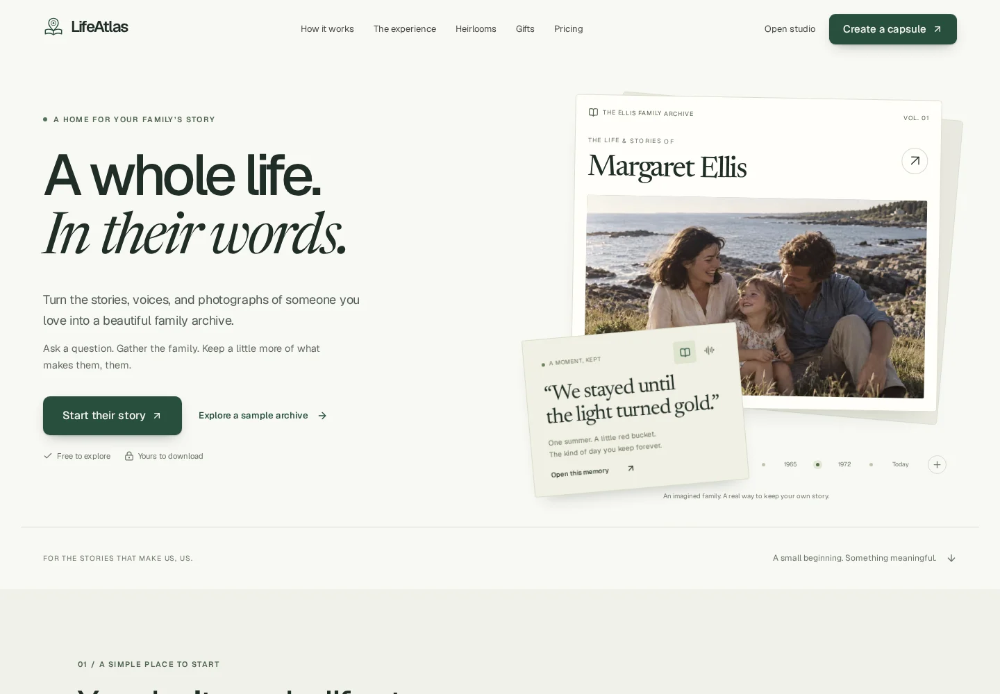
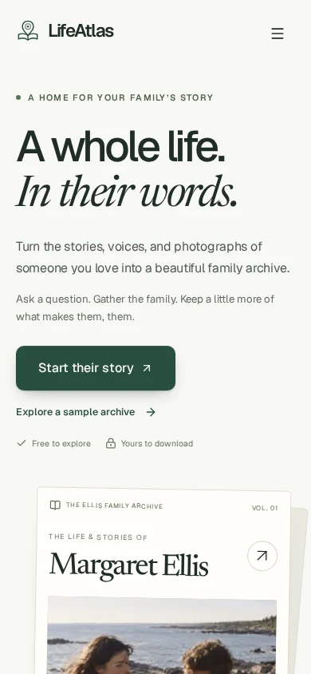

# LifeAtlas design refresh

A clearer first impression for a product with substantial working archive, audio, map, and heirloom experiences.

## Design

- **Geist** provides a clear, compact interface; **Newsreader** adds an expressive voice to story headlines. Fonts are self-hosted. Newsreader is included as compressed variable WOFF2 files with its OFL license.
- Paper, sage, and deep green surfaces create distinct chapters. The updated wordmark, buttons, spacing, and type hierarchy carry through the marketing site and studio.
- The landing page explains the journey from one question to a family archive, with playable narration, an interactive map, family contributions, a book preview, future letters, pricing, and honest preview limitations.
- All 22 public information destinations in the header and footer now have content. `/demo` opens the fictional Margaret Ellis archive. Unknown marketing paths return 404.
- Phone navigation scrolls so its lower links remain reachable. Layouts fit a 390px viewport without horizontal scrolling.

## Desktop



## Phone



## Validation

| Check | Result |
| --- | --- |
| `npm run build` | Pass; includes TypeScript and static generation |
| ESLint on all edited TS/TSX files and browser tests | Pass |
| `npm run test:e2e` | 4 passing checks across desktop and Pixel 7 projects |
| Public route coverage | All 22 pages return 200; unknown route returns 404; demo redirects correctly |
| Interaction coverage | Narration plays and pauses, FAQ expands, primary CTA opens capsule creation, mobile menu reaches its final link |
| Visual review | Landing desktop/phone, pricing, heirlooms, and studio |

The pre-existing full-repository lint baseline contains 14 errors and 2 warnings, predominantly React hook rules in existing application components. This change does not disable those rules or claim the full lint gate passes.

## Review locally

Use Node 20.9 or later:

```sh
npm ci
npm run dev
```

For the production browser checks:

```sh
npx playwright install chromium
npm run build
npm run test:e2e
```

Start at `/`, then try `/how-it-works`, `/heirlooms`, `/pricing`, `/demo`, and `/app/capsules/new`.

## Product boundaries

This remains a local demonstration. Secure accounts, cloud storage, backups, real payments, invitation delivery, printing, shipping, and scheduled future delivery are not connected. Public policy pages are clearly labeled preview information, not finalized launch policies. Existing missing account/operations pages are outside this visual refresh.
